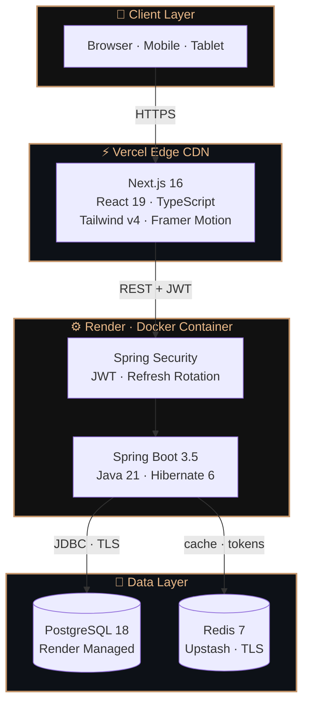
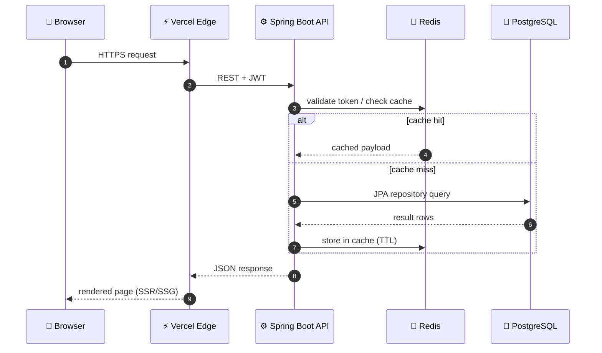
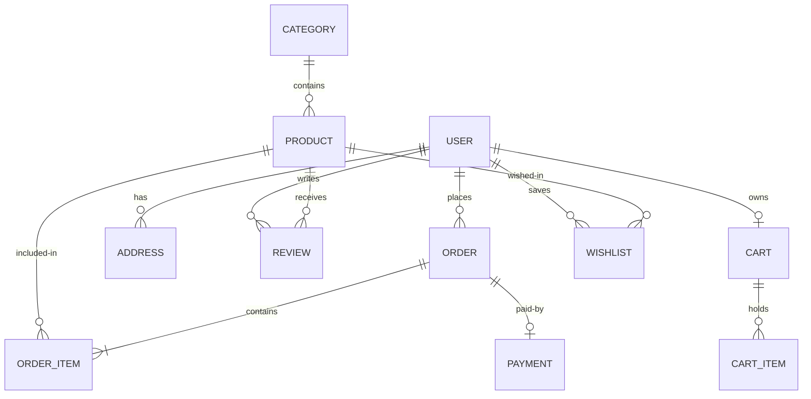

<div align="center">


<br/>


<br/><br/>

> ### *Premium Indian Fashion E-Commerce*
> #### Founded & engineered by **Akanksha Deshmukh** — built from zero, deployed to production.

<br/>

<a href="https://anvyra-klb2.vercel.app">

</a>
&nbsp;
<a href="https://anvyra.onrender.com/api">

</a>
&nbsp;
<a href="https://anvyra.onrender.com/swagger-ui/index.html">

</a>

<br/><br/>

<a href="https://www.linkedin.com/in/akanksha-deshmukh-26210b244/">

</a>
&nbsp;
<a href="https://github.com/akankshad1712/ANVYRA">

</a>

<br/><br/>


&nbsp;

&nbsp;


</div>

<br/>

<!-- ═══════════════════════════════════════════════════════════════════════ -->
<!--                         THE BRAND                                          -->
<!-- ═══════════════════════════════════════════════════════════════════════ -->


<div align="center">

## &nbsp;◈&nbsp; <samp>the_brand</samp>

</div>

<table>
<tr>
<td valign="top" width="58%">

### ✦ ANVYRA — Premium Indian Fashion

**ANVYRA** is a real premium fashion brand — not a tutorial, not a clone.

Every line of code, every API endpoint, every pixel was crafted by **one person** — founder and full stack engineer **Akanksha Deshmukh**. From brand identity to cloud infrastructure, this is a production-grade platform that is live on the internet right now.

> *"Built For Legacy."*

Built with **Java 21**, **Spring Boot 3.5**, **Next.js 16**, **PostgreSQL**, **Redis**, **Docker**, and **GitHub Actions** — deployed on **Vercel + Render**.

</td>
<td valign="top" align="center" width="42%">

```
╔══════════════════════════╗
║                          ║
║     A N V Y R A          ║
║    ────────────────     ║
║   🛍️  Fashion            ║
║   ⚙️  Full Stack         ║
║   ☁️  Cloud Native       ║
║   🔐  JWT Secured        ║
║   ⚡  Redis Cache        ║
║   🐳  Docker Ready       ║
║   🚀  Live in Prod       ║
║                          ║
╚══════════════════════════╝
```

</td>
</tr>
</table>

<br/>

<!-- ═══════════════════════════════════════════════════════════════════════ -->
<!--                         LIVE URLS                                          -->
<!-- ═══════════════════════════════════════════════════════════════════════ -->


<div align="center">

## &nbsp;◈&nbsp; <samp>live_urls</samp>

| Service | URL | Status |
|---|---|:---:|
| 🛍️ **Frontend** | [anvyra-klb2.vercel.app](https://anvyra-klb2.vercel.app) |  |
| ⚙️ **Backend API** | [anvyra.onrender.com/api](https://anvyra.onrender.com/api) |  |
| 📖 **API Docs** | [Swagger UI](https://anvyra.onrender.com/swagger-ui/index.html) |  |
| 💻 **Source** | [akankshad1712/ANVYRA](https://github.com/akankshad1712/ANVYRA) |  |

</div>

<br/>

<!-- ═══════════════════════════════════════════════════════════════════════ -->
<!--                         ARCHITECTURE — 3D + Mermaid                        -->
<!-- ═══════════════════════════════════════════════════════════════════════ -->


<div align="center">

## &nbsp;◈&nbsp; <samp>architecture</samp>

</div>

### ✦ 3D Isometric Layer Stack

```
      ▗▄▄▄▄▄▄▄▄▄▄▄▄▄▄▄▄▄▄▄▄▄▄▄▄▄▄▄▄▄▄▄▄▄▄▄▄▄▄▄▄▄▄▄▄▄▄▄▄▄▄▄▖
      ▝▀   🖥️  PRESENTATION   ·   Next.js 16 · React 19 · Tailwind v4   ▘
           ▗▄▄▄▄▄▄▄▄▄▄▄▄▄▄▄▄▄▄▄▄▄▄▄▄▄▄▄▄▄▄▄▄▄▄▄▄▄▄▄▄▄▄▄▄▄▖
           ▝▀   ⚙️  APPLICATION   ·   Spring Boot 3.5 · Java 21 · JWT   ▘
                ▗▄▄▄▄▄▄▄▄▄▄▄▄▄▄▄▄▄▄▄▄▄▄▄▄▄▄▄▄▄▄▄▄▄▄▄▄▄▄▄▄▄▄▄▖
                ▝▀   💾  DATA   ·   PostgreSQL 18 · Redis 7 (Upstash)   ▘
                     ▗▄▄▄▄▄▄▄▄▄▄▄▄▄▄▄▄▄▄▄▄▄▄▄▄▄▄▄▄▄▄▄▄▄▄▄▄▄▄▄▖
                     ▝▀   ☁️  INFRASTRUCTURE   ·   Vercel · Render   ▘
```

<br/>

### ✦ System Architecture (Container View) — live diagram on GitHub



<br/>

### ✦ Request Flow (Sequence) — live diagram on GitHub



<br/>

### ✦ Data Model (Entity Relationships) — live ER diagram on GitHub



<br/>

### ✦ Architectural Decisions

| Concern | Decision | Why |
|---|---|---|
| **Frontend hosting** | Vercel Edge CDN | Global low-latency, auto CI/CD on push |
| **Backend hosting** | Render Docker | Containerized, predictable, cheap scale |
| **Auth** | JWT access + refresh rotation | Stateless, scalable, Redis-revocable |
| **Token storage** | Redis (Upstash TLS) | Fast invalidation on logout, TTL-safe |
| **Primary DB** | PostgreSQL 18 | Relational integrity for orders & payments |
| **Caching** | Redis 7 | Offload reads, cache product lists & sessions |
| **State (FE)** | Zustand + TanStack Query | Lightweight global + smart server state |
| **Security** | Spring Security + RBAC | Role-based admin vs customer access |
| **CI/CD** | GitHub Actions | Build → test → deploy on every push |

<br/>

<!-- ═══════════════════════════════════════════════════════════════════════ -->
<!--                         TECH STACK                                         -->
<!-- ═══════════════════════════════════════════════════════════════════════ -->


<div align="center">

## &nbsp;◈&nbsp; <samp>tech_stack</samp>

<br/>


<br/>

### ✦ 3D Isometric Tech Stack

```
                     ╱─────────────────────────────────────────╲
                   ╱   🖥️  FRONTEND   ·   Next.js 16            ╲
                 ╱      React 19 · TypeScript · Tailwind v4     ╲
                ╱      Framer Motion · Zustand · TanStack Query   ╲
               ╱─────────────────────────────────────────────────────╲
             ╱   ⚙️  BACKEND   ·   Spring Boot 3.5 · Java 21         ╲
           ╱      Spring Security · JWT · Hibernate 6 · Maven        ╲
          ╱      REST API · DTOs · Repositories · Exception Handler   ╲
         ╱─────────────────────────────────────────────────────────────────╲
       ╱   💾  DATA   ·   PostgreSQL 18   +   Redis 7                         ╲
      ╱       Primary Store            Cache · Token Store                    ╲
     ╱───────────────────────────────────────────────────────────────────────────╲
   ╱   ☁️  CLOUD & DEVOPS   ·   Vercel · Render · Docker · GitHub Actions          ╲
  ╱       Edge CDN · Container · CI/CD · IaC (render.yaml · vercel.json)            ╲
 ╱─────────────────────────────────────────────────────────────────────────────────────╲
```

<br/>

### ✦ Full Tech Table

| Layer | Technology | Version | Purpose |
|:---:|---|:---:|---|
| 🖥️ | **Next.js** | 16 | App Router · SSR · SSG |
| ⚛️ | **React** | 19 | UI rendering |
| 🔷 | **TypeScript** | 5 | Type safety |
| 🎨 | **Tailwind CSS** | v4 | Styling |
| 🎬 | **Framer Motion** | 12 | Animations |
| 🗂️ | **Zustand** | 5 | Global state |
| 🔄 | **TanStack Query** | 5 | Server state · caching |
| ☕ | **Spring Boot** | 3.5 | REST API |
| ☕ | **Java** | 21 | Backend runtime |
| 🔐 | **Spring Security** | — | Auth · roles |
| 🎟️ | **JWT** | — | Access + refresh tokens |
| 🐘 | **PostgreSQL** | 18 | Primary database |
| ⚡ | **Redis** | 7 | Cache · token store |
| 🐳 | **Docker** | — | Containerization |
| 🚀 | **Vercel** | — | Frontend CDN |
| 🌐 | **Render** | — | Backend cloud |
| 🔄 | **GitHub Actions** | — | CI/CD |

</div>

<br/>

<!-- ═══════════════════════════════════════════════════════════════════════ -->
<!--                         FEATURES                                          -->
<!-- ═══════════════════════════════════════════════════════════════════════ -->


<div align="center">

## &nbsp;◈&nbsp; <samp>features</samp>

</div>

### ✦ 3D Isometric Feature Tower

```
                     ╱─────────────────────────────────────────╲
                   ╱   🛠️  ADMIN   ·   Management               ╲
                 ╱      Dashboard · CRUD · Users · Revenue       ╲
                ╱─────────────────────────────────────────────────╲
              ╱   🛒  CART & ORDERS   ·   Checkout                   ╲
            ╱      Wishlist · Multi-step · Address · Tracking       ╲
           ╱───────────────────────────────────────────────────────────╲
         ╱   🔐  AUTH   ·   Security                                     ╲
       ╱      JWT · Refresh Rotation · Redis · RBAC · Protected        ╲
      ╱────────────────────────────────────────────────────────────────────╲
    ╱   🛍️  SHOPPING   ·   Catalog                                        ╲
  ╱      Filters · Price · Sort · Search · Gallery · Size · Color         ╲
 ╱────────────────────────────────────────────────────────────────────────────╲
```

<br/>

### ✦ Feature Breakdown

<table>
<tr>
<td align="center" valign="top" width="25%">

**🛍️ Shopping**
<br/>
Product catalog<br/>
Category filters<br/>
Price range<br/>
Sort options<br/>
Product gallery<br/>
Size & color picker<br/>
Real-time search

</td>
<td align="center" valign="top" width="25%">

**🔐 Auth**
<br/>
Register · Login<br/>
JWT access tokens<br/>
Refresh rotation<br/>
Redis invalidation<br/>
Protected routes<br/>
Admin role guard

</td>
<td align="center" valign="top" width="25%">

**🛒 Cart & Orders**
<br/>
Persistent cart<br/>
Wishlist<br/>
Multi-step checkout<br/>
Address book<br/>
Order history<br/>
Status tracking

</td>
<td align="center" valign="top" width="25%">

**🛠️ Admin**
<br/>
Live stats dashboard<br/>
Product CRUD<br/>
Category management<br/>
Order management<br/>
User management<br/>
Revenue analytics

</td>
</tr>
</table>

<br/>

<!-- ═══════════════════════════════════════════════════════════════════════ -->
<!--                         PROJECT STRUCTURE — 3D + tree                      -->
<!-- ═══════════════════════════════════════════════════════════════════════ -->


<div align="center">

## &nbsp;◈&nbsp; <samp>project_structure — 3D view</samp>

</div>

### ✦ 3D Isometric Module Map

```
                     ╱─────────────────────────────────────────╲
                   ╱   🖥️  FRONTEND   ·   Next.js 16            ╲
                 ╱      app · components · services               ╲
                ╱      store · lib · types · styles                ╲
               ╱─────────────────────────────────────────────────────╲
             ╱   ⚙️  BACKEND   ·   Spring Boot 3.5 · Java 21         ╲
           ╱      controller · service · repository                    ╲
          ╱      entity · dto · security · config · exception           ╲
         ╱─────────────────────────────────────────────────────────────────╲
       ╱   💾  DATA   ·   PostgreSQL 18   +   Redis 7                         ╲
      ╱       (Render Managed DB)        (Upstash · TLS)                      ╲
     ╱───────────────────────────────────────────────────────────────────────────╲
   ╱   ☁️  INFRASTRUCTURE   ·   Vercel · Render · Docker · GitHub Actions          ╲
  ╱       render.yaml · vercel.json · docker-compose.yml · scripts/seed.sql        ╲
 ╱─────────────────────────────────────────────────────────────────────────────────────╲
```

<br/>

### ✦ Detailed File Tree

```
ANVYRA/
│
├── frontend/                      Next.js 16 · App Router
│   ├── app/
│   │   ├── (public)/              Home · Shop · Product
│   │   ├── (customer)/            Cart · Checkout · Orders · Wishlist
│   │   ├── (auth)/                Login · Register
│   │   └── (admin)/               Dashboard · Products · Orders · Users
│   ├── components/                UI component library
│   ├── services/                  Typed API clients
│   ├── store/                     Zustand atoms
│   ├── lib/                       API client · utilities
│   └── types/                     TypeScript interfaces
│
├── backend/                       Spring Boot 3.5 · Java 21
│   └── src/main/java/com/anvyra/
│       ├── controller/            12 REST controllers
│       ├── service/               Business logic
│       ├── repository/            12 JPA repositories
│       ├── entity/                11 JPA entities
│       ├── dto/                   23 DTOs
│       ├── security/              JWT · UserDetails
│       ├── config/                CORS · Redis · Security
│       └── exception/             Global error handler
│
├── scripts/seed.sql               5 categories · 15 products
├── docker-compose.yml             One-command local stack
├── render.yaml                    Render IaC config
└── vercel.json                    Vercel deployment config
```

<br/>

<!-- ═══════════════════════════════════════════════════════════════════════ -->
<!--                         API REFERENCE                                      -->
<!-- ═══════════════════════════════════════════════════════════════════════ -->


<div align="center">

## &nbsp;◈&nbsp; <samp>api_reference</samp>

</div>

<details>
<summary><b>▶ &nbsp; 24 Live REST Endpoints</b></summary>

<br/>

| Method | Endpoint | Access | Description |
|---|---|:---:|---|
| `POST` | `/api/auth/register` | 🌐 | Create account |
| `POST` | `/api/auth/login` | 🌐 | Login · get tokens |
| `POST` | `/api/auth/refresh` | 🌐 | Rotate access token |
| `POST` | `/api/auth/logout` | 🔐 | Invalidate in Redis |
| `GET` | `/api/products` | 🌐 | Paginated · filtered |
| `GET` | `/api/products/{id}` | 🌐 | Product detail |
| `GET` | `/api/categories` | 🌐 | All categories |
| `GET` | `/api/cart` | 🔐 | User cart |
| `POST` | `/api/cart/items` | 🔐 | Add to cart |
| `PUT` | `/api/cart/items/{id}` | 🔐 | Update quantity |
| `DELETE` | `/api/cart/items/{id}` | 🔐 | Remove item |
| `GET` | `/api/wishlist` | 🔐 | Wishlist |
| `POST` | `/api/wishlist/{productId}` | 🔐 | Toggle item |
| `POST` | `/api/orders` | 🔐 | Place order |
| `GET` | `/api/orders` | 🔐 | Order history |
| `GET` | `/api/orders/{id}` | 🔐 | Order detail |
| `GET` | `/api/addresses` | 🔐 | Saved addresses |
| `POST` | `/api/addresses` | 🔐 | Add address |
| `GET` | `/api/reviews/product/{id}` | 🌐 | Product reviews |
| `POST` | `/api/reviews` | 🔐 | Submit review |
| `GET` | `/api/admin/dashboard/stats` | 👑 | Live stats |
| `POST` | `/api/products` | 👑 | Create product |
| `PUT` | `/api/products/{id}` | 👑 | Update product |
| `PATCH` | `/api/orders/{id}/status` | 👑 | Update status |

🌐 Public &nbsp;·&nbsp; 🔐 JWT Required &nbsp;·&nbsp; 👑 Admin Only

**Interactive Docs →** https://anvyra.onrender.com/swagger-ui/index.html

</details>

<br/>

<!-- ═══════════════════════════════════════════════════════════════════════ -->
<!--                         QUICK START                                        -->
<!-- ═══════════════════════════════════════════════════════════════════════ -->


<div align="center">

## &nbsp;◈&nbsp; <samp>quick_start</samp>

</div>

### ✦ 3D Isometric Deployment Flow

```
                     ╱─────────────────────────────────────────╲
                   ╱   🚀  DEPLOY   ·   Live in Production        ╲
                 ╱      Vercel (Frontend) · Render (Backend)      ╲
                ╱─────────────────────────────────────────────────╲
              ╱   🔧  BUILD   ·   Containerize                      ╲
            ╱      Docker · Maven · Next.js build                  ╲
           ╱───────────────────────────────────────────────────────────╲
         ╱   🧪  TEST   ·   Continuous Integration                    ╲
       ╱      GitHub Actions · Lint · Build verification              ╲
      ╱────────────────────────────────────────────────────────────────────╲
    ╱   ⬇️  SETUP   ·   Local Environment                                ╲
  ╱      git clone · .env · seed.sql · docker compose up                ╲
 ╱────────────────────────────────────────────────────────────────────────────╲
```

<br/>

### 🐳 &nbsp; Docker

```bash
git clone https://github.com/akankshad1712/ANVYRA.git
cd ANVYRA
cp .env.example .env        # set DB_PASSWORD + APP_JWT_SECRET
docker compose up -d
```

| | URL |
|---|---|
| Frontend | http://localhost:3000 |
| API | http://localhost:8080/api |
| Swagger | http://localhost:8080/swagger-ui/index.html |

### 💻 &nbsp; Manual

```bash
# Backend — needs PostgreSQL:5432 + Redis:6379
cd backend
export DB_PASSWORD=yourpassword
export APP_JWT_SECRET=AtLeast64CharacterSecretKey!!
./mvnw spring-boot:run

# Frontend
cd frontend
echo "NEXT_PUBLIC_API_URL=http://localhost:8080/api" > .env.local
npm install && npm run dev
```

<br/>

<!-- ═══════════════════════════════════════════════════════════════════════ -->
<!--                         ENVIRONMENT VARIABLES                              -->
<!-- ═══════════════════════════════════════════════════════════════════════ -->


<div align="center">

## &nbsp;◈&nbsp; <samp>environment_variables</samp>

| Scope | Variable | Purpose |
|:---:|---|---|
| BE | `DB_URL` | PostgreSQL JDBC URL |
| BE | `DB_USERNAME` | DB username |
| BE | `DB_PASSWORD` | DB password |
| BE | `APP_JWT_SECRET` | JWT signing key (64+ chars) |
| BE | `REDIS_URL` | Redis TLS URL (`rediss://`) |
| BE | `CORS_ALLOWED_ORIGINS` | Allowed frontend origin |
| FE | `NEXT_PUBLIC_API_URL` | Backend API base URL |

</div>

<br/>

<!-- ═══════════════════════════════════════════════════════════════════════ -->
<!--                         THE FOUNDER                                        -->
<!-- ═══════════════════════════════════════════════════════════════════════ -->


<div align="center">

## &nbsp;◈&nbsp; <samp>the_founder</samp>

```
╔════════════════════════════════════════════════════════════════╗
║                                                                ║
║    ✦   AKANKSHA DESHMUKH   ✦                                   ║
║                                                                ║
║    Founder  ·  Brand Architect  ·  Full Stack Engineer         ║
║                                                                ║
║    ◈  Designed brand identity & visual language                ║
║    ◈  Architected and built the entire Spring Boot API         ║
║    ◈  Built the complete Next.js 16 frontend from scratch      ║
║    ◈  Designed PostgreSQL schema & Redis caching strategy      ║
║    ◈  Configured Docker, CI/CD, cloud deployment pipeline      ║
║    ◈  Deployed to Vercel + Render — live on the internet       ║
║                                                                ║
║    "ANVYRA is not just a project.                              ║
║     It is the brand I am building."                            ║
║                                                                ║
╚════════════════════════════════════════════════════════════════╝
```

<br/>

<a href="https://www.linkedin.com/in/akanksha-deshmukh-26210b244/">

</a>
&nbsp;
<a href="https://github.com/akankshad1712">

</a>

</div>

<br/>

<!-- ═══════════════════════════════════════════════════════════════════════ -->
<!--                         FOOTER                                             -->
<!-- ═══════════════════════════════════════════════════════════════════════ -->


<div align="center">


<br/>

*Crafted with ambition, precision, and zero shortcuts.*
<br/>
**— Akanksha Deshmukh, Founder of ANVYRA**

<br/><br/>


&nbsp;

&nbsp;


</div>
