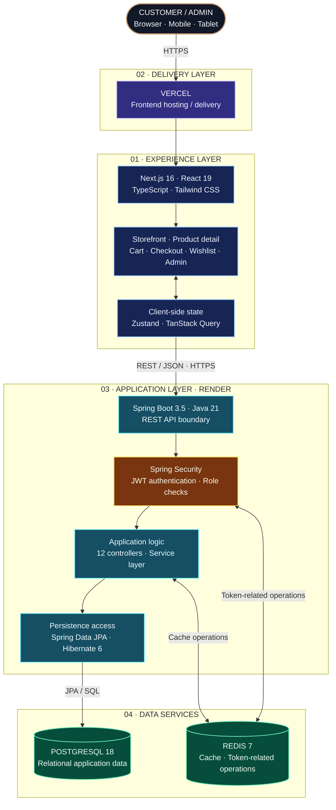
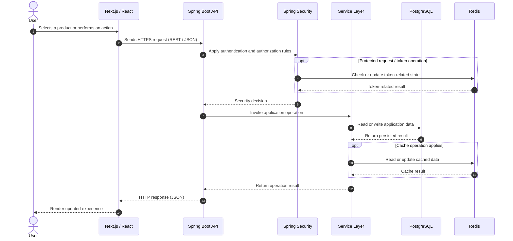
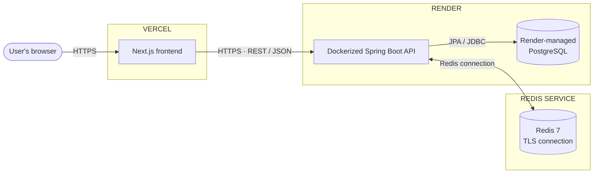

<div align="center">


<br/>

<a href="https://anvyra-klb2.vercel.app/">
  
</a>
&nbsp;
<a href="https://anvyra.onrender.com/swagger-ui/index.html">
  
</a>
&nbsp;
<a href="https://github.com/akankshad1712/ANVYRA">
  
</a>

<br/><br/>


<br/><br/>

**A premium Indian fashion storefront, engineered as a connected full-stack product.**

*Brand identity · Customer experience · Backend services · Data · Deployment*

<br/>


<br/><br/>

<a href="https://www.linkedin.com/in/akanksha-deshmukh-26210b244/">LinkedIn</a>
&nbsp;·&nbsp;
<a href="https://github.com/akankshad1712">GitHub</a>
&nbsp;·&nbsp;
<a href="https://github.com/akankshad1712/ANVYRA">Repository</a>

<br/><br/>

<sub>Designed and developed by <strong>Akanksha Deshmukh</strong></sub>

</div>

---

## 01 — Product overview

**ANVYRA** is a premium Indian fashion e-commerce platform built around a complete shopping journey: discovering products, managing a cart and wishlist, checking out, tracking orders and administering the catalogue.

The project connects a **Next.js 16 / React 19** frontend to a **Java 21 / Spring Boot 3.5** backend. PostgreSQL provides relational persistence, while Redis supports caching and token-related operations. The frontend and backend are deployed separately using Vercel and Render.

> **Build philosophy**  
> Treat the storefront, API, authentication, data model and deployment setup as parts of one product—not as isolated demo components.

### Project snapshot

| Area | Implementation |
|---|---|
| Product type | Full-stack fashion e-commerce application |
| Frontend | Next.js 16, React 19, TypeScript 5, Tailwind CSS v4 |
| Backend | Java 21, Spring Boot 3.5, Spring Security, Hibernate 6 |
| Persistence | PostgreSQL 18, Spring Data JPA |
| Supporting data service | Redis 7 |
| API surface | 12 REST controllers · 24 API endpoints |
| Data model | 11 JPA entities · 23 DTOs |
| Authentication | JWT access and refresh tokens; role-based authorization |
| Containerization | Docker / Docker Compose |
| Frontend hosting | Vercel |
| Backend hosting | Render |

## 02 — Live application

| Destination | Purpose |
|---|---|
| [ANVYRA storefront](https://anvyra-klb2.vercel.app/) | Browse the deployed customer-facing application |
| [Backend API](https://anvyra.onrender.com/api) | Backend API base URL |
| [Swagger UI](https://anvyra.onrender.com/swagger-ui/index.html) | Explore documented API operations |
| [GitHub repository](https://github.com/akankshad1712/ANVYRA) | Browse the source code |

---

## 03 — Architecture at a glance

The architecture is presented as a set of connected responsibility zones. A browser interacts with the Next.js experience; the frontend calls the Spring Boot API over HTTPS; backend application logic uses PostgreSQL for persistent records and Redis for cache/token-related operations.

### 3.1 Platform architecture



### 3.2 Request lifecycle

This sequence shows the typical request path from a user action to a backend response. Authentication checks apply to protected operations; token-related Redis operations are shown as conditional rather than required for every request.



### 3.3 Deployment topology



### 3.4 Architecture responsibilities

| Component | Responsibility | Main interaction |
|---|---|---|
| Next.js / React | Renders the storefront and application screens | Browser interaction |
| Zustand | Holds client-side application state | Frontend components |
| TanStack Query | Manages server-state fetching and caching | REST API |
| Spring Boot controllers | Exposes HTTP endpoints | Frontend requests |
| Spring Security / JWT | Applies authentication and role-based access rules | Protected API operations |
| Service layer | Coordinates application and business operations | Controllers, repositories and supporting services |
| Spring Data JPA / Hibernate | Maps Java entities to relational persistence | PostgreSQL |
| PostgreSQL | Stores relational application data | Repository layer |
| Redis | Supports caching and token-related operations | Backend services |
| Vercel | Hosts the frontend | Browser delivery |
| Render | Hosts the backend and managed database | Application hosting |

---

## 04 — Feature map

<table>
  <tr>
    <td width="50%" valign="top">

### 🛍️ Catalogue and discovery
- Product catalogue
- Category filters
- Price-range filtering
- Sorting options
- Product gallery
- Size and colour selection
- Product search

    </td>
    <td width="50%" valign="top">

### 🔐 Authentication and access
- Registration and login
- JWT access tokens
- Refresh-token workflow
- Redis-backed token invalidation
- Protected routes
- Admin role guard

    </td>
  </tr>
  <tr>
    <td width="50%" valign="top">

### 🛒 Customer shopping
- Persistent cart
- Wishlist
- Multi-step checkout
- Address book
- Order history
- Order status tracking

    </td>
    <td width="50%" valign="top">

### ⚙️ Administration
- Dashboard statistics
- Product create, read, update and delete
- Category management
- Order management
- User management
- Revenue analytics

    </td>
  </tr>
</table>

---

## 05 — Technology landscape

| Layer | Technology | Version | Role in the application |
|---|---|---:|---|
| Web framework | Next.js | 16 | App Router and frontend application |
| UI library | React | 19 | Component-based UI |
| Language | TypeScript | 5 | Typed frontend code |
| Styling | Tailwind CSS | v4 | Utility-first styling |
| Motion | Framer Motion | 12 | Interface animations |
| Client state | Zustand | 5 | Global client-side state |
| Server state | TanStack Query | 5 | API data fetching and caching |
| Backend framework | Spring Boot | 3.5 | REST API and application runtime |
| Backend language | Java | 21 | Backend implementation |
| Security | Spring Security | — | Authentication and authorization |
| Token format | JWT | — | Access and refresh tokens |
| ORM | Hibernate / JPA | 6 | Object-relational mapping |
| Primary database | PostgreSQL | 18 | Relational data persistence |
| Cache / token support | Redis | 7 | Cache and token-related operations |
| Containerization | Docker | — | Container-based local/deployment setup |
| Frontend hosting | Vercel | — | Frontend deployment |
| Backend hosting | Render | — | Backend deployment |
| CI/CD | GitHub Actions | — | Workflow automation |

---

## 06 — Backend API reference

The backend exposes **24 API endpoints** across authentication, catalogue, cart, wishlist, orders, addresses, reviews and administration.

<details>
<summary><strong>View all 24 endpoints</strong></summary>

<br/>

| Method | Endpoint | Access | Purpose |
|---|---|---|---|
| `POST` | `/api/auth/register` | Public | Create an account |
| `POST` | `/api/auth/login` | Public | Authenticate and obtain tokens |
| `POST` | `/api/auth/refresh` | Public | Refresh access token |
| `POST` | `/api/auth/logout` | Authenticated | Invalidate token state |
| `GET` | `/api/products` | Public | List products with pagination / filters |
| `GET` | `/api/products/{id}` | Public | Retrieve product details |
| `GET` | `/api/categories` | Public | List categories |
| `GET` | `/api/cart` | Authenticated | Retrieve the user's cart |
| `POST` | `/api/cart/items` | Authenticated | Add a cart item |
| `PUT` | `/api/cart/items/{id}` | Authenticated | Update cart quantity |
| `DELETE` | `/api/cart/items/{id}` | Authenticated | Remove a cart item |
| `GET` | `/api/wishlist` | Authenticated | Retrieve wishlist |
| `POST` | `/api/wishlist/{productId}` | Authenticated | Toggle a wishlist item |
| `POST` | `/api/orders` | Authenticated | Place an order |
| `GET` | `/api/orders` | Authenticated | Retrieve order history |
| `GET` | `/api/orders/{id}` | Authenticated | Retrieve order details |
| `GET` | `/api/addresses` | Authenticated | List saved addresses |
| `POST` | `/api/addresses` | Authenticated | Add an address |
| `GET` | `/api/reviews/product/{id}` | Public | Retrieve product reviews |
| `POST` | `/api/reviews` | Authenticated | Submit a review |
| `GET` | `/api/admin/dashboard/stats` | Admin | Retrieve dashboard statistics |
| `POST` | `/api/products` | Admin | Create a product |
| `PUT` | `/api/products/{id}` | Admin | Update a product |
| `PATCH` | `/api/orders/{id}/status` | Admin | Update order status |

**Access legend:** Public = no login required; Authenticated = JWT required; Admin = admin-authorized request.

**Interactive API documentation:** [Open Swagger UI](https://anvyra.onrender.com/swagger-ui/index.html)

</details>

---

## 07 — Repository structure

```text
ANVYRA/
│
├── frontend/                         # Next.js 16 application
│   ├── app/
│   │   ├── (public)/                 # Home, shop and product routes
│   │   ├── (customer)/               # Cart, checkout, orders, wishlist
│   │   ├── (auth)/                   # Login and registration
│   │   └── (admin)/                  # Dashboard and management routes
│   ├── components/                   # Reusable UI components
│   ├── services/                     # Typed API clients
│   ├── store/                        # Zustand state stores
│   ├── lib/                          # API client and utilities
│   └── types/                        # TypeScript interfaces
│
├── backend/                          # Spring Boot 3.5 / Java 21
│   └── src/main/java/com/anvyra/
│       ├── controller/               # 12 REST controllers
│       ├── service/                  # Application and business logic
│       ├── repository/               # 12 JPA repositories
│       ├── entity/                   # 11 JPA entities
│       ├── dto/                      # 23 data transfer objects
│       ├── security/                 # JWT and UserDetails
│       ├── config/                   # CORS, Redis and security config
│       └── exception/                # Global exception handling
│
├── scripts/
│   └── seed.sql                      # Sample categories and products
├── docker-compose.yml                # Local multi-service setup
├── render.yaml                       # Render deployment configuration
└── vercel.json                       # Vercel configuration
```

---

## 08 — Run locally

### Prerequisites

- Git
- Docker and Docker Compose **or** local PostgreSQL and Redis
- Java 21
- Node.js and npm

### Option A — Docker Compose

```bash
# 1. Clone the repository
git clone https://github.com/akankshad1712/ANVYRA.git
cd ANVYRA

# 2. Create your local environment file
cp .env.example .env

# 3. Edit .env and provide your own database password
#    and a strong, randomly generated JWT signing secret.

# 4. Start the application stack
docker compose up -d
```

When the services have started, use the local addresses configured by the project:

| Service | Local address |
|---|---|
| Frontend | `http://localhost:3000` |
| Backend API | `http://localhost:8080/api` |
| Swagger UI | `http://localhost:8080/swagger-ui/index.html` |

### Option B — Run backend and frontend separately

Start PostgreSQL and Redis first. Then configure the backend environment variables using values for your local services.

```bash
# Backend
cd backend

export DB_PASSWORD="your-local-database-password"
export APP_JWT_SECRET="replace-with-a-long-random-secret"

./mvnw spring-boot:run
```

In a second terminal:

```bash
# Frontend
cd frontend

echo "NEXT_PUBLIC_API_URL=http://localhost:8080/api" > .env.local

npm install
npm run dev
```

> **Configuration note:** The commands above are local-development examples. Use your own secrets and database credentials. Do not commit `.env` files, production credentials or signing keys to source control.

---

## 09 — Environment configuration

| Scope | Variable | Purpose |
|---|---|---|
| Backend | `DB_URL` | PostgreSQL JDBC connection URL |
| Backend | `DB_USERNAME` | Database username |
| Backend | `DB_PASSWORD` | Database password |
| Backend | `APP_JWT_SECRET` | JWT signing secret |
| Backend | `REDIS_URL` | Redis connection URL |
| Backend | `CORS_ALLOWED_ORIGINS` | Permitted frontend origin(s) |
| Frontend | `NEXT_PUBLIC_API_URL` | Backend API base URL |

Set environment variables in your local environment or deployment provider. Keep credentials private and use separate values for development and production.

---

## 10 — Engineering notes

The project brings together several practical full-stack engineering concerns:

| Concern | Implementation in ANVYRA |
|---|---|
| API organisation | REST controllers, service layer and repositories |
| API contracts | DTOs separate request/response models from persistence entities |
| Authentication | JWT access and refresh-token workflow |
| Authorization | Role-based access for protected operations |
| Relational persistence | PostgreSQL with JPA entities and repositories |
| Cache support | Redis integration |
| Frontend state | Zustand and TanStack Query |
| Local environment | Docker Compose |
| API discoverability | Swagger UI / OpenAPI interface |
| Deployment | Separate frontend and backend hosting |

---

## 11 — About the developer

<div align="center">

### Akanksha Deshmukh

**Project Founder · Full-Stack Developer**

ANVYRA was developed as an end-to-end product initiative, spanning brand identity, frontend experience, backend APIs, database integration and cloud deployment.

<a href="https://www.linkedin.com/in/akanksha-deshmukh-26210b244/">
  
</a>
&nbsp;
<a href="https://github.com/akankshad1712">
  
</a>

</div>

---

<div align="center">


**ANVYRA — Dress the Story.**

<sub>Designed with intention. Engineered with care. Built end to end.</sub>

</div>
