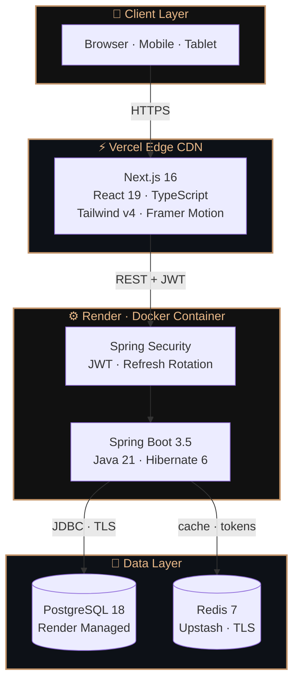
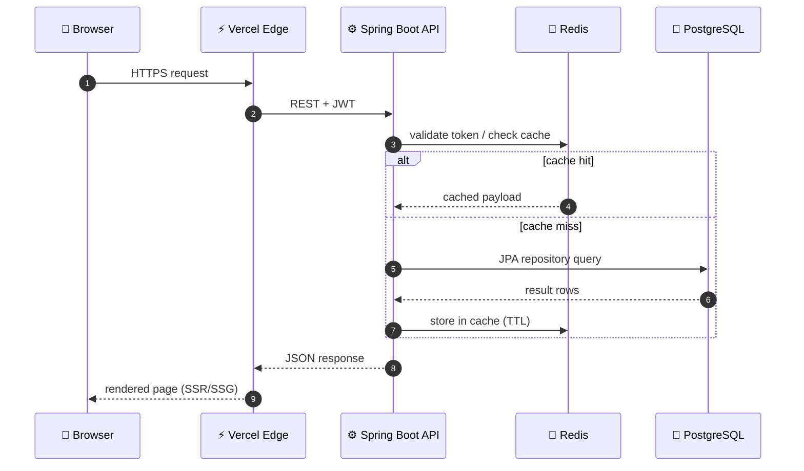
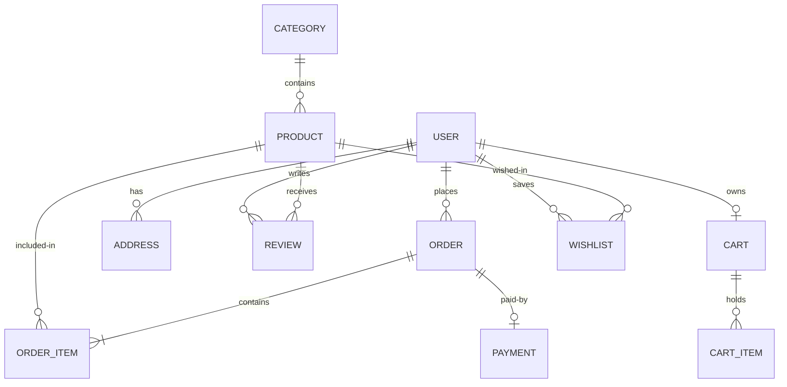

<div align="center">

<!-- ════════════════════════════════════════════════════════════════════════ -->
<!--  ANVYRA · Premium Indian Fashion · Engineered solo · Live in production   -->
<!--  README design system — champagne / graphite palette · Figma-inspired   -->
<!-- ════════════════════════════════════════════════════════════════════════ -->


<br/>


<br/><br/>

<!-- LIVE STATUS PILL -->
<p>
  
  &nbsp;
  
  &nbsp;
  
</p>

<!-- TYPING TAGLINE -->
<p>
  <a href="https://github.com/akankshad1712/ANVYRA">
    
  </a>
</p>

<!-- PRIMARY CTAs -->
<a href="https://anvyra-klb2.vercel.app">
  
</a>
&nbsp;
<a href="https://anvyra.onrender.com/swagger-ui/index.html">
  
</a>
&nbsp;
<a href="https://github.com/akankshad1712/ANVYRA">
  
</a>

<br/><br/>

<!-- SOCIAL PROOF -->

&nbsp;

&nbsp;


</div>

<br/>

<!-- ════════════════════════════════════════════════════════════════════════ -->
<!--  THE BRAND                                                                -->
<!-- ════════════════════════════════════════════════════════════════════════ -->


<div align="center">

## ◈ &nbsp; <samp>the_brand</samp>

</div>

<table>
<tr>
<td valign="top" width="58%">

### ✦ ANVYRA — Premium Indian Fashion

**ANVYRA** is a real premium fashion brand — not a tutorial, not a clone.

Every line of code, every API endpoint, every pixel was crafted by **one person** — founder and full stack engineer **Akanksha Deshmukh**. From brand identity to cloud infrastructure, this is a production-grade platform that is live on the internet right now.

> *"Built For Legacy."*

Engineered with **Java 21**, **Spring Boot 3.5**, **Next.js 16**, **PostgreSQL 18**, **Redis 7**, **Docker**, and **GitHub Actions** — deployed on **Vercel + Render**.

</td>
<td valign="top" align="center" width="42%">

```
╔══════════════════════════╗
║                          ║
║     A N V Y R A          ║
║    ────────────────     ║
║   🛍️  Fashion            ║
║   ⚙️  Full Stack         ║
║   ☁️  Cloud Native       ║
║   🔐  JWT Secured        ║
║   ⚡  Redis Cache        ║
║   🐳  Docker Ready       ║
║   🚀  Live in Prod       ║
║                          ║
╚══════════════════════════╝
```

</td>
</tr>
</table>

<br/>

<!-- ════════════════════════════════════════════════════════════════════════ -->
<!--  DESIGN SYSTEM  ·  Figma-style color, type & spacing tokens                -->
<!-- ════════════════════════════════════════════════════════════════════════ -->


<div align="center">

## ◈ &nbsp; <samp>design_system</samp>

<br/>
<sub>A Figma-inspired token set — the visual language behind every screen of ANVYRA.</sub>

</div>

### ✦ Color Palette

<table>
<tr>
<td align="center" width="20%">
<br/>
<sub><b>Champagne</b></sub><br/>
<code>#C4956A</code><br/>
<sub>primary · accent</sub>
</td>
<td align="center" width="20%">
<br/>
<sub><b>Soft Gold</b></sub><br/>
<code>#E8B888</code><br/>
<sub>secondary · text</sub>
</td>
<td align="center" width="20%">
<br/>
<sub><b>Bronze</b></sub><br/>
<code>#B98B5E</code><br/>
<sub>stroke · divider</sub>
</td>
<td align="center" width="20%">
<br/>
<sub><b>Graphite</b></sub><br/>
<code>#111111</code><br/>
<sub>surface · label</sub>
</td>
<td align="center" width="20%">
<br/>
<sub><b>Onyx</b></sub><br/>
<code>#0D1117</code><br/>
<sub>background</sub>
</td>
</tr>
</table>

### ✦ Typography Scale

| Role | Family | Weight | Use |
|:---:|---|:---:|---|
| **Display** | Playfair Display | 700 | Brand mark · hero headlines |
| **Heading** | DM Sans | 600 | Section titles · cards |
| **Body** | DM Sans | 400 | Paragraphs · UI text |
| **Mono** | JetBrains Mono | 500 | Code · tokens · labels |

### ✦ Design Principles

| ◈ | Principle | In practice |
|:---:|---|---|
| ✦ | **Editorial restraint** | Generous whitespace, serif display over sans body — the fashion-magazine feel |
| ✦ | **Token-driven** | Colors, type, radius, shadows all live as design tokens, not one-off values |
| ✦ | **Motion with intent** | Framer Motion used to guide attention, never to decorate |
| ✦ | **Premium by default** | Hover swap on product cards, micro-interactions, soft shadows |

<br/>

<!-- ════════════════════════════════════════════════════════════════════════ -->
<!--  LIVE URLS  ·  BENTO GRID                                                 -->
<!-- ════════════════════════════════════════════════════════════════════════ -->


<div align="center">

## ◈ &nbsp; <samp>live_urls</samp>

<br/>

<table>
<tr>
<td align="center" valign="middle" width="50%">

<a href="https://anvyra-klb2.vercel.app"><b>🛍️ &nbsp; Frontend Store</b></a>
<br/>
<sub>Next.js 16 · Vercel Edge CDN</sub>
<br/><br/>


</td>
<td align="center" valign="middle" width="50%">

<a href="https://anvyra.onrender.com/api"><b>⚙️ &nbsp; Backend REST API</b></a>
<br/>
<sub>Spring Boot 3.5 · Render Docker</sub>
<br/><br/>


</td>
</tr>
<tr>
<td align="center" valign="middle" width="50%">

<a href="https://anvyra.onrender.com/swagger-ui/index.html"><b>📖 &nbsp; API Documentation</b></a>
<br/>
<sub>Swagger UI · OpenAPI 3</sub>
<br/><br/>


</td>
<td align="center" valign="middle" width="50%">

<a href="https://github.com/akankshad1712/ANVYRA"><b>💻 &nbsp; Source Repository</b></a>
<br/>
<sub>Monorepo · frontend + backend</sub>
<br/><br/>


</td>
</tr>
</table>

</div>

<br/>

<!-- ════════════════════════════════════════════════════════════════════════ -->
<!--  ARCHITECTURE                                                             -->
<!-- ════════════════════════════════════════════════════════════════════════ -->


<div align="center">

## ◈ &nbsp; <samp>architecture</samp>

</div>

### ✦ 3D Isometric Layer Stack

```
      ▗▄▄▄▄▄▄▄▄▄▄▄▄▄▄▄▄▄▄▄▄▄▄▄▄▄▄▄▄▄▄▄▄▄▄▄▄▄▄▄▄▄▄▄▄▄▄▄▄▄▄▄▖
      ▝▀   🖥️  PRESENTATION   ·   Next.js 16 · React 19 · Tailwind v4   ▘
           ▗▄▄▄▄▄▄▄▄▄▄▄▄▄▄▄▄▄▄▄▄▄▄▄▄▄▄▄▄▄▄▄▄▄▄▄▄▄▄▄▄▄▄▄▄▄▖
           ▝▀   ⚙️  APPLICATION   ·   Spring Boot 3.5 · Java 21 · JWT   ▘
                ▗▄▄▄▄▄▄▄▄▄▄▄▄▄▄▄▄▄▄▄▄▄▄▄▄▄▄▄▄▄▄▄▄▄▄▄▄▄▄▄▄▄▄▄▖
                ▝▀   💾  DATA   ·   PostgreSQL 18 · Redis 7 (Upstash)   ▘
                     ▗▄▄▄▄▄▄▄▄▄▄▄▄▄▄▄▄▄▄▄▄▄▄▄▄▄▄▄▄▄▄▄▄▄▄▄▄▄▄▄▖
                     ▝▀   ☁️  INFRASTRUCTURE   ·   Vercel · Render   ▘
```

### ✦ System Architecture — container view



### ✦ Request Flow — sequence



### ✦ Data Model — entity relationships



### ✦ Architectural Decisions

| Concern | Decision | Why |
|---|---|---|
| **Frontend hosting** | Vercel Edge CDN | Global low-latency, auto CI/CD on push |
| **Backend hosting** | Render Docker | Containerized, predictable, cheap scale |
| **Auth** | JWT access + refresh rotation | Stateless, scalable, Redis-revocable |
| **Token storage** | Redis (Upstash TLS) | Fast invalidation on logout, TTL-safe |
| **Primary DB** | PostgreSQL 18 | Relational integrity for orders & payments |
| **Caching** | Redis 7 | Offload reads, cache product lists & sessions |
| **State (FE)** | Zustand + TanStack Query | Lightweight global + smart server state |
| **Security** | Spring Security + RBAC | Role-based admin vs customer access |
| **CI/CD** | GitHub Actions | Build → test → deploy on every push |

<br/>

<!-- ════════════════════════════════════════════════════════════════════════ -->
<!--  FEATURES  ·  BENTO GRID                                                  -->
<!-- ════════════════════════════════════════════════════════════════════════ -->


<div align="center">

## ◈ &nbsp; <samp>features</samp>

<br/>
<sub>A bento-grid view of everything ANVYRA ships — four pillars, one platform.</sub>

<br/><br/>

<table>
<tr>
<td align="left" valign="top" width="25%" bgcolor="111111">

### 🛍️ &nbsp; Shopping
<br/>
✦ &nbsp; Product catalog<br/>
✦ &nbsp; Category filters<br/>
✦ &nbsp; Price range<br/>
✦ &nbsp; Sort options<br/>
✦ &nbsp; Product gallery<br/>
✦ &nbsp; Size & color picker<br/>
✦ &nbsp; Real-time search

</td>
<td align="left" valign="top" width="25%" bgcolor="111111">

### 🔐 &nbsp; Auth
<br/>
✦ &nbsp; Register · Login<br/>
✦ &nbsp; JWT access tokens<br/>
✦ &nbsp; Refresh rotation<br/>
✦ &nbsp; Redis invalidation<br/>
✦ &nbsp; Protected routes<br/>
✦ &nbsp; Admin role guard

</td>
<td align="left" valign="top" width="25%" bgcolor="111111">

### 🛒 &nbsp; Cart & Orders
<br/>
✦ &nbsp; Persistent cart<br/>
✦ &nbsp; Wishlist<br/>
✦ &nbsp; Multi-step checkout<br/>
✦ &nbsp; Address book<br/>
✦ &nbsp; Order history<br/>
✦ &nbsp; Status tracking

</td>
<td align="left" valign="top" width="25%" bgcolor="111111">

### 🛠️ &nbsp; Admin
<br/>
✦ &nbsp; Live stats dashboard<br/>
✦ &nbsp; Product CRUD<br/>
✦ &nbsp; Category management<br/>
✦ &nbsp; Order management<br/>
✦ &nbsp; User management<br/>
✦ &nbsp; Revenue analytics

</td>
</tr>
</table>

</div>

<br/>

<!-- ════════════════════════════════════════════════════════════════════════ -->
<!--  TECH STACK                                                               -->
<!-- ════════════════════════════════════════════════════════════════════════ -->


<div align="center">

## ◈ &nbsp; <samp>tech_stack</samp>

<br/>


<br/><br/>

| Layer | Technology | Version | Purpose |
|:---:|---|:---:|---|
| 🖥️ | **Next.js** | 16 | App Router · SSR · SSG |
| ⚛️ | **React** | 19 | UI rendering |
| 🔷 | **TypeScript** | 5 | Type safety |
| 🎨 | **Tailwind CSS** | v4 | Styling |
| 🎬 | **Framer Motion** | 12 | Animations |
| 🗂️ | **Zustand** | 5 | Global state |
| 🔄 | **TanStack Query** | 5 | Server state · caching |
| ☕ | **Spring Boot** | 3.5 | REST API |
| ☕ | **Java** | 21 | Backend runtime |
| 🔐 | **Spring Security** | — | Auth · roles |
| 🎟️ | **JWT** | — | Access + refresh tokens |
| 🐘 | **PostgreSQL** | 18 | Primary database |
| ⚡ | **Redis** | 7 | Cache · token store |
| 🐳 | **Docker** | — | Containerization |
| 🚀 | **Vercel** | — | Frontend CDN |
| 🌐 | **Render** | — | Backend cloud |
| 🔄 | **GitHub Actions** | — | CI/CD |

</div>

<br/>

<!-- ════════════════════════════════════════════════════════════════════════ -->
<!--  PROJECT STRUCTURE                                                        -->
<!-- ════════════════════════════════════════════════════════════════════════ -->


<div align="center">

## ◈ &nbsp; <samp>project_structure</samp>

</div>

```
ANVYRA/
│
├── frontend/                      Next.js 16 · App Router
│   ├── app/
│   │   ├── (public)/              Home · Shop · Product
│   │   ├── (customer)/            Cart · Checkout · Orders · Wishlist
│   │   ├── (auth)/                Login · Register
│   │   └── (admin)/               Dashboard · Products · Orders · Users
│   ├── components/                UI component library
│   ├── services/                  Typed API clients
│   ├── store/                     Zustand atoms
│   ├── lib/                       API client · utilities
│   └── types/                     TypeScript interfaces
│
├── backend/                       Spring Boot 3.5 · Java 21
│   └── src/main/java/com/anvyra/
│       ├── controller/            12 REST controllers
│       ├── service/               Business logic
│       ├── repository/            12 JPA repositories
│       ├── entity/                11 JPA entities
│       ├── dto/                   23 DTOs
│       ├── security/              JWT · UserDetails
│       ├── config/                CORS · Redis · Security
│       └── exception/             Global error handler
│
├── scripts/seed.sql               5 categories · 15 products
├── docker-compose.yml             One-command local stack
├── render.yaml                    Render IaC config
└── vercel.json                    Vercel deployment config
```

<br/>

<!-- ════════════════════════════════════════════════════════════════════════ -->
<!--  API REFERENCE                                                            -->
<!-- ════════════════════════════════════════════════════════════════════════ -->


<div align="center">

## ◈ &nbsp; <samp>api_reference</samp>

</div>

<details>
<summary><b>▶ &nbsp; 24 Live REST Endpoints</b></summary>

<br/>

| Method | Endpoint | Access | Description |
|---|---|:---:|---|
| `POST` | `/api/auth/register` | 🌐 | Create account |
| `POST` | `/api/auth/login` | 🌐 | Login · get tokens |
| `POST` | `/api/auth/refresh` | 🌐 | Rotate access token |
| `POST` | `/api/auth/logout` | 🔐 | Invalidate in Redis |
| `GET` | `/api/products` | 🌐 | Paginated · filtered |
| `GET` | `/api/products/{id}` | 🌐 | Product detail |
| `GET` | `/api/categories` | 🌐 | All categories |
| `GET` | `/api/cart` | 🔐 | User cart |
| `POST` | `/api/cart/items` | 🔐 | Add to cart |
| `PUT` | `/api/cart/items/{id}` | 🔐 | Update quantity |
| `DELETE` | `/api/cart/items/{id}` | 🔐 | Remove item |
| `GET` | `/api/wishlist` | 🔐 | Wishlist |
| `POST` | `/api/wishlist/{productId}` | 🔐 | Toggle item |
| `POST` | `/api/orders` | 🔐 | Place order |
| `GET` | `/api/orders` | 🔐 | Order history |
| `GET` | `/api/orders/{id}` | 🔐 | Order detail |
| `GET` | `/api/addresses` | 🔐 | Saved addresses |
| `POST` | `/api/addresses` | 🔐 | Add address |
| `GET` | `/api/reviews/product/{id}` | 🌐 | Product reviews |
| `POST` | `/api/reviews` | 🔐 | Submit review |
| `GET` | `/api/admin/dashboard/stats` | 👑 | Live stats |
| `POST` | `/api/products` | 👑 | Create product |
| `PUT` | `/api/products/{id}` | 👑 | Update product |
| `PATCH` | `/api/orders/{id}/status` | 👑 | Update status |

🌐 Public &nbsp;·&nbsp; 🔐 JWT Required &nbsp;·&nbsp; 👑 Admin Only

**Interactive Docs →** https://anvyra.onrender.com/swagger-ui/index.html

</details>

<br/>

<!-- ════════════════════════════════════════════════════════════════════════ -->
<!--  QUICK START                                                              -->
<!-- ════════════════════════════════════════════════════════════════════════ -->


<div align="center">

## ◈ &nbsp; <samp>quick_start</samp>

</div>

### 🐳 &nbsp; Docker

```bash
git clone https://github.com/akankshad1712/ANVYRA.git
cd ANVYRA
cp .env.example .env        # set DB_PASSWORD + APP_JWT_SECRET
docker compose up -d
```

| | URL |
|---|---|
| Frontend | http://localhost:3000 |
| API | http://localhost:8080/api |
| Swagger | http://localhost:8080/swagger-ui/index.html |

### 💻 &nbsp; Manual

```bash
# Backend — needs PostgreSQL:5432 + Redis:6379
cd backend
export DB_PASSWORD=yourpassword
export APP_JWT_SECRET=AtLeast64CharacterSecretKey!!
./mvnw spring-boot:run

# Frontend
cd frontend
echo "NEXT_PUBLIC_API_URL=http://localhost:8080/api" > .env.local
npm install && npm run dev
```

<br/>

<!-- ════════════════════════════════════════════════════════════════════════ -->
<!--  ENVIRONMENT VARIABLES                                                     -->
<!-- ════════════════════════════════════════════════════════════════════════ -->


<div align="center">

## ◈ &nbsp; <samp>environment_variables</samp>

| Scope | Variable | Purpose |
|:---:|---|---|
| BE | `DB_URL` | PostgreSQL JDBC URL |
| BE | `DB_USERNAME` | DB username |
| BE | `DB_PASSWORD` | DB password |
| BE | `APP_JWT_SECRET` | JWT signing key (64+ chars) |
| BE | `REDIS_URL` | Redis TLS URL (`rediss://`) |
| BE | `CORS_ALLOWED_ORIGINS` | Allowed frontend origin |
| FE | `NEXT_PUBLIC_API_URL` | Backend API base URL |

</div>

<br/>

<!-- ════════════════════════════════════════════════════════════════════════ -->
<!--  THE FOUNDER                                                              -->
<!-- ════════════════════════════════════════════════════════════════════════ -->


<div align="center">

## ◈ &nbsp; <samp>the_founder</samp>

```
╔════════════════════════════════════════════════════════════════╗
║                                                                ║
║    ✦   AKANKSHA DESHMUKH   ✦                                   ║
║                                                                ║
║    Founder  ·  Brand Architect  ·  Full Stack Engineer         ║
║                                                                ║
║    ◈  Designed brand identity & visual language                ║
║    ◈  Architected and built the entire Spring Boot API         ║
║    ◈  Built the complete Next.js 16 frontend from scratch      ║
║    ◈  Designed PostgreSQL schema & Redis caching strategy      ║
║    ◈  Configured Docker, CI/CD, cloud deployment pipeline      ║
║    ◈  Deployed to Vercel + Render — live on the internet       ║
║                                                                ║
║    "ANVYRA is not just a project.                              ║
║     It is the brand I am building."                            ║
║                                                                ║
╚════════════════════════════════════════════════════════════════╝
```

<br/>

<a href="https://www.linkedin.com/in/akanksha-deshmukh-26210b244/">
  
</a>
&nbsp;
<a href="https://github.com/akankshad1712">
  
</a>

</div>

<br/>

<!-- ════════════════════════════════════════════════════════════════════════ -->
<!--  FOOTER                                                                   -->
<!-- ════════════════════════════════════════════════════════════════════════ -->


<div align="center">


<br/>

*Crafted with ambition, precision, and zero shortcuts.*
<br/>
**— Akanksha Deshmukh, Founder of ANVYRA**

<br/><br/>


&nbsp;

&nbsp;


</div>
